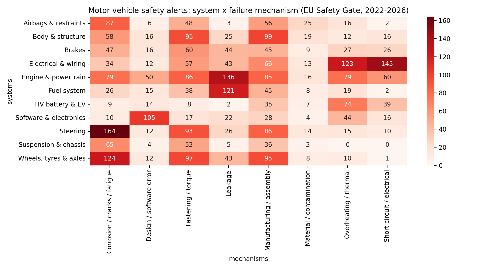
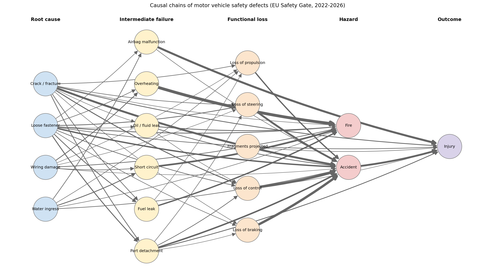

# Causal Knowledge Extraction from EU Motor Vehicle Safety Alerts

Data-driven root cause analysis of vehicle safety defects using the EU Safety Gate rapid alert system (2022–2026).

## Motivation

Recall and safety alert texts describe how a defect turns into a hazard, but they are written as free text and are rarely analysed systematically. This project turns these descriptions into structured causal knowledge.

The data covers many manufacturers and vehicle types, which makes it possible to ask **sector-level** questions about where vehicle safety defects occur, how they fail and which hazards they lead to.

**Research questions**

1. Can cause–effect relations be extracted reliably from regulatory safety alert texts with causal linguistic patterns?
2. Which vehicle systems and failure mechanisms dominate safety defects?
3. Do failure mechanisms determine the type of hazard (fire vs. injury)?
4. Which root causes act as hubs in the causal network?

## Data

* **Source:** [EU Safety Gate](https://ec.europa.eu/safety-gate-alerts/) (European Commission), official weekly report XML export
* **Scope:** all alerts published 2022–2026 (17,344 alerts), of which **1,873 motor vehicle alerts**
* **Key field:** `danger` – the authority's description of the defect and its consequences

> Attribution: European Union, Safety Gate. Counts may change slightly when the notebook is re-run, because new weekly reports are added every Friday.

## Method

| Step | Description |
|---|---|
| 1. Collection | Download all weekly reports since 2022 and parse every alert |
| 2. Cleaning | Select motor vehicle alerts and remove the repeated regulatory compliance sentence |
| 3. Causal extraction | Rule-based extraction with causal connectives (*may lead to, can cause, resulting in, due to* …), chain splitting, reversed connectives and reference resolution |
| 4. Validation | Manual annotation of 100 randomly sampled cause–effect pairs |
| 5. Exploratory clustering | Sentence embeddings (all-MiniLM-L6-v2) + K-means on cause texts |
| 6. FMEA-style tagging | Each alert tagged by **vehicle system** and **failure mechanism** |
| 7. Hazard pathways | Share of fire vs. injury risk per failure mechanism |
| 8. Causal knowledge graph | Causes and effects mapped to standard events; layered graph and hub analysis |

## Results

**Extraction quality**

* 2,939 cause–effect pairs; at least one pair in 83.9% of alerts
* Manual validation (n = 100): **93% cause accuracy, 95% effect accuracy, 91% pair accuracy**

**Two hazard pathways**

| Mechanism | Fire risk | Injury risk |
|---|---|---|
| Short circuit / electrical | 90% | 26% |
| Overheating / thermal | 80% | 28% |
| Leakage | 69% | 36% |
| Fastening / torque | 24% | 80% |
| Corrosion / cracks / fatigue | 12% | 89% |

Thermal mechanisms lead predominantly to fire, whereas structural mechanisms lead predominantly to loss of control, accidents and injury.

**Hub root cause**

Loose fasteners / torque errors are linked to the largest number of distinct effects (15) and causal links (161), and about one third of these links lead to thermal outcomes (fuel leaks, overheating, fire). Assembly quality control may therefore reduce several hazard types at once.

**Other observations**

* Densest system × mechanism combinations: steering × cracks/fatigue, electrical × short circuit/overheating, engine and fuel system × leakage, wheels/axles × fatigue, airbags × deterioration
* The distribution of vehicle systems among alerts is broadly stable across 2022–2026




## Limitations and future work

* The rule-based extractor struggles with unresolved pronouns, parallel causes ("due to X and due to Y") and missing spaces after full stops
* Some keywords appear in both the system and the mechanism dictionaries, which inflates a few cells of the matrix
* Alert texts often compress causal chains, so intermediate steps are missing
* Next steps: supervised causal sentence classification, transformer-based cause/effect span extraction, and ontology-based normalisation of causal events

## Repository structure

```
├── safety_gate_causal_analysis.ipynb   # full pipeline
├── data/
│   └── validation_labeled.csv          # manually annotated validation sample
└── figures/
    ├── fig_system_mechanism_heatmap.png
    └── fig_causal_chains_layered.png
```

## How to run

Open the notebook in Google Colab and run all cells. The notebook downloads the data directly from the Safety Gate portal; no API key is required.

## Author

Yiğit Öner – B.Sc. in Statistics, Hacettepe University
